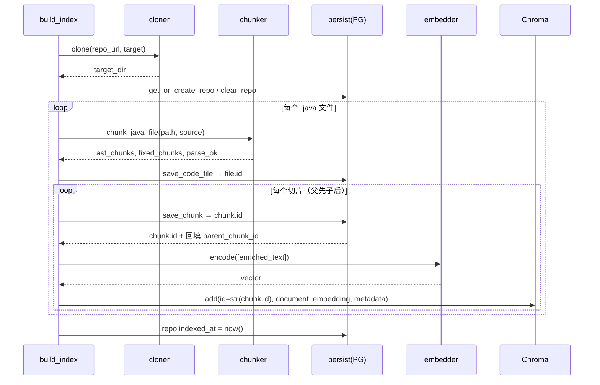

# Code RAG 一期（索引构建管线）技术设计

> Spec：rag-one
> 生成时间：2026-11-02
> 状态：待审批
> 关联需求：R-001 ~ R-012

## 1. 架构概述

一期只覆盖**离线索引构建**：`克隆仓库 → 遍历 Java 文件 → tree-sitter AST 层级切分（同时产出 fixed 基线）→ 增强文本 → 向量化 → 写入 PostgreSQL + ChromaDB`。检索与问答仅预留接口契约。

```
┌────────────────────────────── scripts/build_index.py（编排入口）──────────────────────────────┐
│                                                                                              │
│  cloner ──→ walker ──→ chunker ──→ persist(PG) ──→ embedder ──→ chroma                       │
│  (克隆)     (找.java)   (AST+fixed)   (存原文/元信息)  (bge-small)   (存向量+元信息)            │
└──────────────────────────────────────────────────────────────────────────────────────────────┘
                         │                                          │
                         ▼                                          ▼
                 PostgreSQL(code_rag)                       ChromaDB(data/chroma)
                 repo / code_file / chunk                   collection: code_chunks
                 （原文 + 元信息，chunk.id 主键）             （增强文本 + 向量，id=str(chunk.id)）
```

FastAPI 侧只读访问 PG 提供切片浏览（`/api/*`），问答接口返回 501。

## 2. 模块设计

### 2.1 目录与职责

| 文件 | 职责 | 状态 |
|------|------|------|
| `app/config.py` | `Settings`：读取 `.env`，解析数据库连接（本地/服务器一键切换）、Chroma 目录、embedding 模型、仓库地址 | 待实现（空占位） |
| `app/database.py` | SQLAlchemy `engine` / `SessionLocal` / `Base` / `get_db` | 待实现（空占位） |
| `app/models.py` | ORM：`Repo` / `CodeFile` / `Chunk` | 待实现（空占位） |
| `app/services/indexing/cloner.py` | 克隆仓库，已存在则跳过 | 待实现（空占位） |
| `app/services/indexing/chunker.py` | AST 层级切分 + fixed 切分；产出 `ChunkData` 列表 | 待实现（空占位） |
| `app/services/indexing/embedder.py` | 加载 sentence-transformers 一次，批量向量化；Chroma 客户端与读写 | 待实现（空占位） |
| `app/services/indexing/persist.py` | PG 写入：repo/file/chunk，幂等清理 | **新建** |
| `scripts/build_index.py` | 编排建库全流程 | 待实现（空占位） |
| `app/routers/chunks.py` | 切片浏览（只读） | 待实现（空占位） |
| `app/routers/query.py` | 问答接口占位（501） | 待实现（空占位） |
| `app/schemas/chunk.py` | 切片浏览出入参 Pydantic 模型 | 待实现（空占位） |
| `app/schemas/query.py` | 问答出入参 Pydantic 模型 | 待实现（空占位） |
| `app/main.py` | 注册路由、应用启动 | 已存在骨架，需扩展 |

### 2.2 关键类型

```python
# chunker.py
@dataclass
class ChunkData:
    chunk_type: str          # class / interface / enum / method / constructor / fixed
    name: str | None
    signature: str | None
    content: str             # 原文
    start_line: int
    end_line: int
    strategy: str            # "ast" | "fixed"
    parent_chunk_id: int | None   # 仅运行时装配；入库后回填
    parent_temp_key: str | None   # AST 阶段用临时键关联父子，入库时映射为真实 id
    chunk_index: int

def chunk_java_file(path: str, source: str) -> tuple[list[ChunkData], list[ChunkData], bool]:
    """返回 (ast_chunks, fixed_chunks, parse_ok)"""
```

> 设计要点：AST 阶段父子关系先用 `parent_temp_key`（如类的临时序号）关联，因为 PG 主键在入库前未知；persist 层插入父切片拿到真实 `id` 后回填 `parent_chunk_id`。

```python
# config.py
class Settings(BaseSettings): ...
settings: Settings

# embedder.py
class Embedder:
    def __init__(self, model_name: str): ...      # 只加载一次
    def encode(self, texts: list[str]) -> list[list[float]]: ...

def get_chroma_client(chroma_dir: str) -> chromadb.ClientAPI: ...
def get_or_create_collection(client) -> Collection: ...
```

## 3. 数据模型

### 3.1 PostgreSQL（库名 `code_rag`）

**repo（仓库）**

| 字段 | 类型 | 必要性 |
|------|------|--------|
| `id` | BIGSERIAL PK | 主键 |
| `name` | VARCHAR(255) NOT NULL | 仓库名，前端展示 |
| `url` | VARCHAR(1024) | 克隆地址，溯源 |
| `clone_dir` | VARCHAR(1024) | 本地克隆路径 |
| `created_at` | TIMESTAMPTZ | 默认 now() |
| `indexed_at` | TIMESTAMPTZ NULL | 最近建库时间 |

> 无 `commit_hash`、无 `branch`（单版本）。

**code_file（源文件）**

| 字段 | 类型 | 必要性 |
|------|------|--------|
| `id` | BIGSERIAL PK | 主键 |
| `repo_id` | BIGINT FK → repo | 所属仓库 |
| `path` | VARCHAR(1024) NOT NULL | 相对仓库根路径 |
| `language` | VARCHAR(50) | 编程语言（java） |
| `parse_ok` | BOOLEAN DEFAULT true | AST 解析是否成功（失败样本作论文素材） |
| `sha256` | CHAR(64) NULL | **[预留]** 内容哈希，供增量重建 |
| `created_at` | TIMESTAMPTZ | 默认 now() |

**chunk（切片）—— 一期核心**

| 字段 | 类型 | 必要性 |
|------|------|--------|
| `id` | BIGSERIAL PK | 切片主键，**亦为 Chroma 文档 id** |
| `file_id` | BIGINT FK → code_file | 归属文件 |
| `chunk_type` | VARCHAR(50) NOT NULL | `class/interface/enum/method/constructor`；fixed 策略时为 `fixed` |
| `name` | VARCHAR(255) NULL | 类名/方法名（fixed 可空） |
| `signature` | VARCHAR(1024) NULL | 完整签名，如 `public <T> T fromJson(String, Class<T>)` |
| `content` | TEXT NOT NULL | 切片原文 |
| `start_line` / `end_line` | INT NOT NULL | 起止行号，溯源基础 |
| `strategy` | VARCHAR(20) NOT NULL | `ast` / `fixed`，消融对比关键字段 |
| `parent_chunk_id` | BIGINT NULL FK → chunk | 层级切分父指针 |
| `chunk_index` | INT NULL | 同文件内顺序（保证展示稳定） |
| `content_hash` | CHAR(64) NULL | **[预留]** 内容哈希，去重/增量 |
| `token_count` | INT NULL | **[预留]** 三期成本/截断控制 |
| `metadata` | JSONB NULL | **[预留]** 灵活扩展 |
| `indexed_at` | TIMESTAMPTZ | 默认 now() |

索引：`chunk(file_id)`、`chunk(strategy)`、`chunk(parent_chunk_id)`。（二期 `pg_trgm(name)` 暂不建。）

```sql
CREATE TABLE repo (
  id         BIGSERIAL PRIMARY KEY,
  name       VARCHAR(255) NOT NULL,
  url        VARCHAR(1024),
  clone_dir  VARCHAR(1024),
  created_at TIMESTAMPTZ NOT NULL DEFAULT now(),
  indexed_at TIMESTAMPTZ
);

CREATE TABLE code_file (
  id         BIGSERIAL PRIMARY KEY,
  repo_id    BIGINT NOT NULL REFERENCES repo(id) ON DELETE CASCADE,
  path       VARCHAR(1024) NOT NULL,
  language   VARCHAR(50),
  parse_ok   BOOLEAN NOT NULL DEFAULT true,
  sha256     CHAR(64),
  created_at TIMESTAMPTZ NOT NULL DEFAULT now()
);

CREATE TABLE chunk (
  id              BIGSERIAL PRIMARY KEY,
  file_id         BIGINT NOT NULL REFERENCES code_file(id) ON DELETE CASCADE,
  chunk_type      VARCHAR(50) NOT NULL,
  name            VARCHAR(255),
  signature       VARCHAR(1024),
  content         TEXT NOT NULL,
  start_line      INT NOT NULL,
  end_line        INT NOT NULL,
  strategy        VARCHAR(20) NOT NULL,
  parent_chunk_id BIGINT REFERENCES chunk(id),
  chunk_index     INT,
  content_hash    CHAR(64),
  token_count     INT,
  metadata        JSONB,
  indexed_at      TIMESTAMPTZ NOT NULL DEFAULT now()
);

CREATE INDEX idx_chunk_file     ON chunk(file_id);
CREATE INDEX idx_chunk_strategy ON chunk(strategy);
CREATE INDEX idx_chunk_parent   ON chunk(parent_chunk_id);
```

建表方式：一期用 `Base.metadata.create_all(bind=engine)` 自动建表（无迁移框架）；DDL 同步存于设计文档，供服务器手工核对。

### 3.2 ChromaDB

```python
collection = client.get_or_create_collection(
    name="code_chunks",
    metadata={"hnsw:space": "cosine"},
)
# 每条记录：
#   id        = str(chunk.id)          # 与 PG 一一对应
#   document  = 增强文本（见 5.3）
#   embedding = bge-small-zh-v1.5 计算的 512 维向量
#   metadata  = {
#       "chunk_id":   int,
#       "file_path":  str,
#       "chunk_type": str,
#       "name":       str or None,
#       "signature":  str or None,
#       "strategy":   "ast" | "fixed",
#       "start_line": int,
#       "end_line":   int,
#       "language":   "java",
#   }
```

- `strategy` 放 metadata，做消融时 `where={"strategy": "ast"}` / `{"strategy": "fixed"}`。
- Chroma 不重复存原文，只存检索与展示所需的最小字段。

## 4. 数据库连接一键切换（R-010）

### 4.1 目标

同一份代码、同一套账号，仅通过环境变量在「本地 Docker 单容器 PG」与「服务器后端容器 + PG 容器」之间切换，**不改代码**。

### 4.2 配置项设计

`.env`（或容器 `environment`）：

```ini
# 部署环境：local | prod
APP_ENV=local

# 数据库（两边一致的固定值）
DB_USER=rag
DB_PASSWORD=rag123
DB_NAME=code_rag
DB_PORT=5432

# 可选：显式覆盖主机（留空则按 APP_ENV 自动解析）
# DB_HOST=

# 可选：直接给完整连接串（最高优先级，便于临时切 SQLite 调试）
# DATABASE_URL=
```

`app/config.py` 解析规则（优先级从高到低）：

1. `DATABASE_URL` 若显式给出 → 直接使用；
2. `DB_HOST` 若显式给出 → 用它；
3. 否则按 `APP_ENV` 解析：`local → localhost`、`prod → pg`（docker-compose 中的 PG 服务名）。

```python
from pydantic_settings import BaseSettings, SettingsConfigDict
from sqlalchemy import URL

class Settings(BaseSettings):
    app_env: str = "local"          # local | prod
    db_user: str = "rag"
    db_password: str = "rag123"
    db_name: str = "code_rag"
    db_port: int = 5432
    db_host: str | None = None
    database_url: str | None = None

    chroma_dir: str = "./data/chroma"
    embedding_model: str = "BAAI/bge-small-zh-v1.5"
    repo_url: str = "https://github.com/google/gson.git"

    model_config = SettingsConfigDict(env_file=".env", extra="ignore")

    @property
    def resolved_db_host(self) -> str:
        return self.db_host or ("localhost" if self.app_env == "local" else "pg")

    @property
    def sqlalchemy_url(self) -> str:
        if self.database_url:
            return self.database_url
        return URL.create(
            drivername="postgresql+psycopg2",
            username=self.db_user, password=self.db_password,
            host=self.resolved_db_host, port=self.db_port,
            database=self.db_name,
        ).render_as_string(hide_password=False)

settings = Settings()
```

> 用 `sqlalchemy.URL.create(...).render_as_string()` 而不是字符串拼 f-string，避免密码含特殊字符时的转义问题。

### 4.3 两套环境对照

| 环境 | `.env` / 容器环境 | 解析主机 | 启动方式 |
|------|-------------------|----------|----------|
| 本地 | `APP_ENV=local` | `localhost` | `docker start code-rag-pg`（已建容器，端口映射 5432） |
| 服务器 | `APP_ENV=prod` | `pg`（compose 服务名） | `docker compose up -d`，backend 与 pg 同网络 |

服务器 `docker-compose.yml` 参考（backend 与 pg 独立容器）：

```yaml
services:
  pg:
    image: postgres:16
    environment:
      POSTGRES_USER: rag
      POSTGRES_PASSWORD: rag123
      POSTGRES_DB: code_rag
    volumes: [ "pgdata:/var/lib/postgresql/data" ]
    # 不对外暴露端口，仅内网服务名可达
  backend:
    build: .
    environment:
      APP_ENV: prod
    depends_on: [ pg ]
volumes: { pgdata: {} }
```

> 切换动作 = 改 `APP_ENV`（或容器环境变量）一项；账号密码/库名/端口两边完全一致，不需要任何代码分支。

### 4.4 数据库连接（database.py）

```python
engine = create_engine(settings.sqlalchemy_url, echo=False, pool_pre_ping=True)
SessionLocal = sessionmaker(bind=engine, autoflush=False, autocommit=False)
Base = declarative_base()

def get_db():
    db = SessionLocal()
    try: yield db
    finally: db.close()
```

`pool_pre_ping=True` 让容器重启后旧连接自动失效重连，避免服务器上 PG 容器先重启导致的悬空连接。

## 5. 层级切分算法（chunker.py）

### 5.1 chunk_type 与父规则

| 语法节点（tree-sitter Java） | chunk_type | 父切片 |
|------------------------------|-----------|--------|
| class_declaration | class | 无（或外层类） |
| interface_declaration | interface | 无（或外层类） |
| enum_declaration | enum | 无（或外层类） |
| method_declaration | method | 所在类切片 |
| constructor_declaration | constructor | 所在类切片 |
| 嵌套 class/interface/enum | 同上 | 外层类切片 |

### 5.2 切分流程

1. 用 `tree_sitter_java` 解析 `.java` 得语法树。
2. 遍历顶层声明节点；类/接口/枚举 → 生成「类型级切片」，记录 `parent_temp_key`（外层临时键，顶层为空）。
3. 在类型节点内找方法/构造器 → 生成「成员级切片」，`parent_temp_key = 所在类临时键`。
4. 嵌套类递归处理，`parent_temp_key` 指向外层类临时键。
5. 每片提取：`name`（标识符）、`signature`（修饰符 + 返回类型 + 方法名 + 参数）、`start/end_line`、`content`（源码文本）、`chunk_type`、`chunk_index`（同文件按出现顺序递增）、`strategy="ast"`。
6. `fixed` 基线：按固定字数/行数滑窗切分，`strategy="fixed"`、`chunk_type="fixed"`、`name/signature/parent_temp_key` 均空。
7. 解析异常（抛错或无语法树）→ `parse_ok=False`，仅保留 fixed 切片。

### 5.3 增强文本（embedding 输入）

入库/送 embedding 前拼接语义前缀，原文仍存 PG `content`：

```
方法: [method: Gson] public <T> T fromJson(String json, Class<T> classOfT)
      + "\n" + content
类:   [class: Gson] public final class Gson
      + "\n" + content
fixed: [fixed: Gson.java:12-40] + "\n" + content
```

`document = f"{prefix}\n{content}"`，让「类名 + 签名」进入向量，提升二期语义检索命中。

## 6. 建库流程与数据流

### 6.1 编排（scripts/build_index.py）

```text
settings = Settings()
client = get_chroma_client(settings.chroma_dir)
collection = get_or_create_collection(client)

clone_repo(settings.repo_url, target_dir)                    # 已存在跳过
repo = persist.get_or_create_repo(...)                       # repo 行
persist.clear_repo(repo.id, collection)                      # 幂等：清 PG 该 repo 数据 + Chroma 对应文档

for f in walk_paths(target_dir, ".java"):
    source = read(f)
    ast_chunks, fixed_chunks, parse_ok = chunk_java_file(f, source)
    file = persist.save_code_file(repo.id, rel_path, "java", parse_ok)   # 先存文件拿 file.id

    # AST 切片：先父后子，保证 parent_chunk_id 可回填
    for c in order_parent_first(ast_chunks):
        row = persist.save_chunk(file.id, c, parent_id_map)  # 插 PG → flush → 得到 row.id
        vec = embedder.encode([c.enriched_text])[0]
        collection.add(ids=[str(row.id)], documents=[c.enriched_text],
                       embeddings=[vec], metadatas=[build_metadata(row)])
    # fixed 切片同理（无父子关系）
    for c in fixed_chunks:
        row = persist.save_chunk(file.id, c, {})
        vec = embedder.encode([c.enriched_text])[0]
        collection.add(...)

repo.indexed_at = now(); commit
print 汇总 + 抽样打印（content + 行号）
```

> **顺序修正**：必须先写 PG 得到 `chunk.id`，再用该 `id` 写入 Chroma（`str(dest.id)`）。原方案「先 chroma.add 再 persist」无法拿到主键，此处修正为「先 PG 后 Chroma」。父子切片也必须父先入库，才能拿到父 `id` 回填子切片的 `parent_chunk_id`。

### 6.2 序列图



### 6.3 幂等重建

单版本无 commit，重跑前先清空该 `repo` 的 `code_file`/`chunk`（`ON DELETE CASCADE` 删文件与切片）及 Chroma 中对应 `repo` 文档（按 metadata 或先 `delete(where=...)`），再全量重建。`sha256`/`content_hash` 预留用于将来增量优化。

## 7. 前端接口契约

### 7.1 切片浏览（一期实现，只读）

| 方法/路径 | 说明 |
|-----------|------|
| `GET /api/repos` | 仓库列表（当前 1 个） |
| `GET /api/repos/{repo_id}/files?page=&size=&language=` | 文件分页列表 |
| `GET /api/files/{file_id}/chunks?strategy=ast\|fixed` | 某文件切片（含层级字段） |
| `GET /api/chunks/{chunk_id}` | 单切片详情（content + 元信息） |

响应中切片含 `chunk_id / chunk_type / name / signature / start_line / end_line / parent_chunk_id / chunk_index`，按 `chunk_index` 升序返回**扁平列表**，前端按 `parent_chunk_id` 自行组装树。

Pydantic 模型（`app/schemas/chunk.py`）：
- `RepoOut`、`FileOut`、`FilePage`、`ChunkOut`、`ChunkDetailOut`

### 7.2 问答（一期仅契约，返回 501）

`POST /api/query`

```json
// request
{ "question": "fromJson 如何反序列化数组?", "session_id": null, "strategy": "ast", "top_k": 5 }
// response（三期实现）
{
  "answer": "...",
  "citations": [
    { "chunk_id": 12, "file_path": "com/google/gson/Gson.java",
      "start_line": 100, "end_line": 108, "content": "..." }
  ],
  "latency_ms": 213
}
```

`app/schemas/query.py` 定义 `QueryRequest` / `Citation` / `QueryResponse`；`routers/query.py` 返回 `HTTPException(status_code=501, detail="Not Implemented")`，三期不改契约直接填实现。

## 8. 技术决策

| 决策 | 选择 | 理由 / 不选其它 |
|------|------|-----------------|
| 数据库切换机制 | `APP_ENV`（local→localhost / prod→pg）+ `DB_HOST` / `DATABASE_URL` 覆盖 | 单变量切换、零代码分支；URL.create 避免转义问题 |
| PG 建表 | `Base.metadata.create_all` | 一期无迁移需求，简单可靠 |
| 原文/向量分工 | PG 存原文与元信息，Chroma 存增强文本 + 向量 + 检索元信息 | 避免大文本双份存储；换模型可重灌向量 |
| 关联方式 | PG `chunk.id` = Chroma 文档 `id` | 检索后回 PG 取原文/行号做溯源 |
| 入库顺序 | 先 PG 拿 id，再写 Chroma | 保证 id 一一对应；父切片先入库回填 parent |
| 父子关联 | 切分阶段 `parent_temp_key`，入库时映射真实 id | 主键入库前未知，需两阶段 |
| Embedding 模型 | `BAAI/bge-small-zh-v1.5`（512 维） | 小、快、中文友好；换模型需重灌 Chroma |
| 向量库 collection | 单集合 `code_chunks`，strategy 放 metadata | 单集 + where 过滤即可按策略单独评测 |
| 依赖补齐 | requirements.txt 增加 `tree-sitter`、`tree-sitter-java` | 当前缺失，AST 切分必需 |

## 9. 影响分析

### 9.1 需修改 / 新建

| 文件 | 改动 |
|------|------|
| `app/config.py` | 新建配置类（当前空占位） |
| `app/database.py` | 新建 engine/session/Base/get_db（当前空占位） |
| `app/models.py` | 新建三张 ORM 表（当前空占位） |
| `app/services/indexing/cloner.py` | 实现克隆（当前空占位） |
| `app/services/indexing/chunker.py` | 实现 AST + fixed 切分（当前空占位） |
| `app/services/indexing/embedder.py` | 实现向量化 + Chroma 读写（当前空占位） |
| `app/services/indexing/persist.py` | **新建** PG 持久化 |
| `scripts/build_index.py` | 新建编排（当前空占位） |
| `app/routers/chunks.py` / `query.py` | 实现接口（当前空占位） |
| `app/schemas/chunk.py` / `query.py` | 定义 Pydantic 模型（当前空占位） |
| `app/main.py` | 注册路由 |
| `requirements.txt` | 增加 tree-sitter、tree-sitter-java |
| `.env` | 增加 `APP_ENV` 与 `DB_*` 配置项 |
| `.env.example` | **新建** 提供本地/服务器配置模板 |

### 9.2 风险

- **依赖安装**：`tree-sitter` 与 `tree-sitter-java` 版本需匹配，否则解析 API 变化导致报错；安装后需冒烟测试。
- **模型下载**：`bge-small-zh-v1.5` 首次需联网下载（约百 MB），离线环境需预置缓存。
- **大仓库耗时**：Gson 切片数千，逐条 `collection.add` 较慢，可小批量（如 batch=64）提交；一期可先逐条保证正确性。
- **固定切分参数**：字数/行数窗口需在实现时设定（建议 300~500 字符或 40 行，含重叠），具体待实现时确定。
